  

<h1 align="center">Hello!, I'm Ibnu Fajar</h1>
<h3 align="center">A person who loves programming (especially in backend) and exploring technology.</h3>
 

- 🔭 I’m currently working on **ODS Mandiri**

- 💬 Ask me about **PHP, Laravel, Backend things**

- 📫 How to reach me? email me at: **ifpersona205@gmail.com**

<h3 align="left">Connect with me:</h3>

  
  

### Languages

  
  
  
  
  
  
  

### Frameworks

  
  
  
  
  

### Databases

  
  
  
  

### Tools

  
  
  
  
  
  
  
  

### GitHub Stats:

 
 

### Pacman playing with my contributions....
<picture>
  <source media="(prefers-color-scheme: dark)" srcset="https://raw.githubusercontent.com/Isjustmy/Isjustmy/output/pacman-contribution-graph-dark.svg">
  <source media="(prefers-color-scheme: light)" srcset="https://raw.githubusercontent.com/Isjustmy/Isjustmy/output/pacman-contribution-graph.svg">
  
</picture>

###
